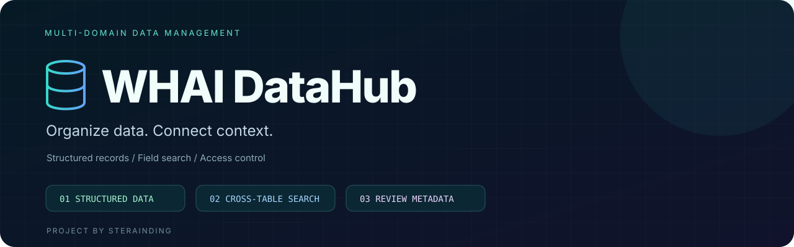
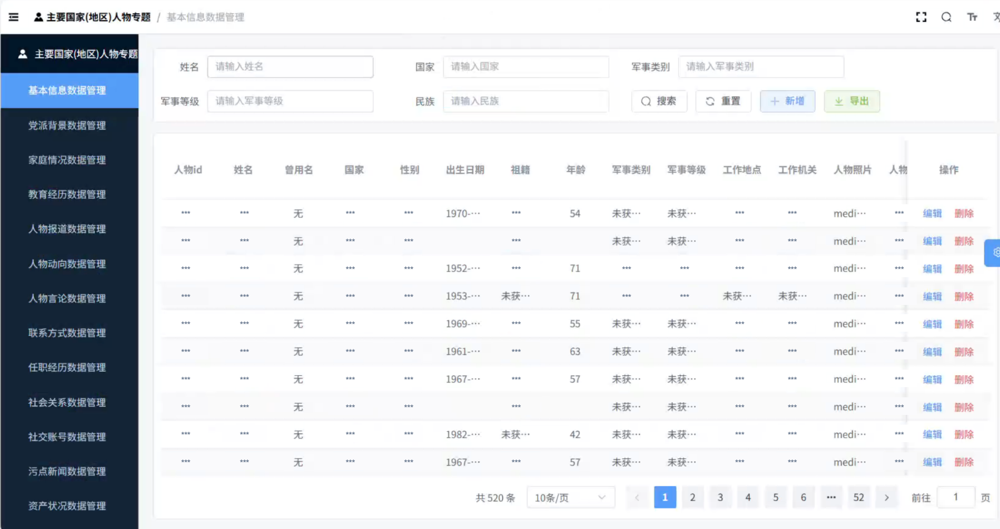
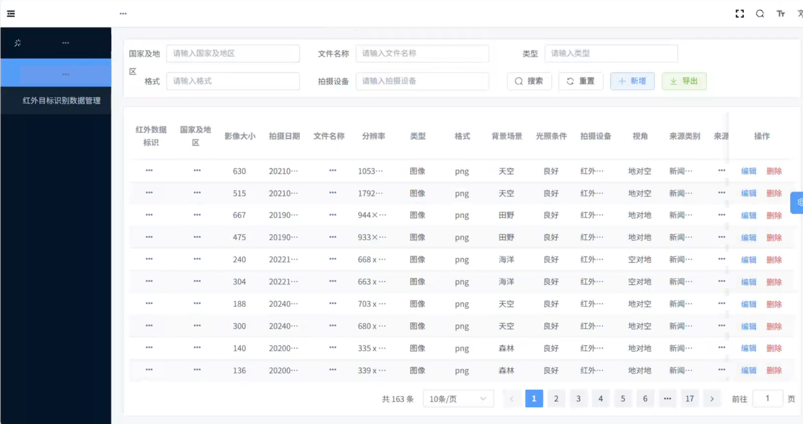
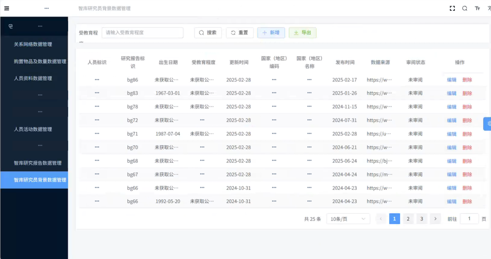
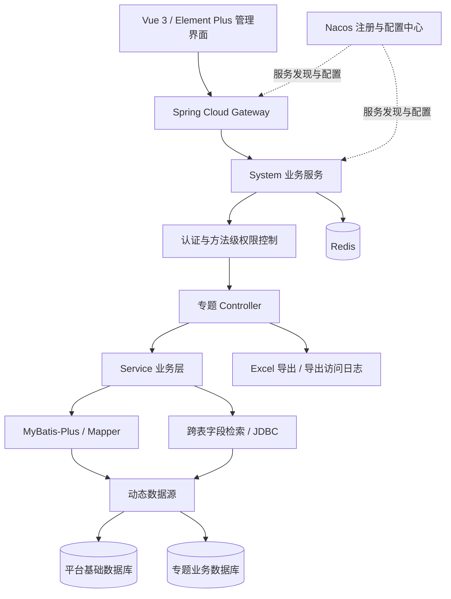

<div align="center">



# WHAI · 专题数据管理平台

**让分散的专题资料，成为可管理、可检索、可审阅的结构化数据。**

围绕人物资料、图像元数据与关联专题，构建集数据维护、条件查询、权限控制和导出于一体的管理系统。


[✨ 项目亮点](#highlights) · [🖼️ 系统界面](#screenshots) · [🏗️ 架构设计](#architecture) · [🚀 运行准备](#getting-started) · [👨‍💻 作者](#author)

</div>

## 💡 项目介绍

多专题数据往往分散在不同表结构和资料来源中：字段各异、查询入口分散，维护时还需要兼顾权限、来源记录与审阅状态。

WHAI 将这些环节组织到统一管理流程中，以 **Controller → Service → Mapper → 数据库** 的分层方式承载专题业务，并通过网关、服务发现及多数据源配置连接底层服务。

项目展示聚焦 **专题数据建模、业务接口实现、跨表字段检索和管理界面集成**。通用认证、权限、持久化等能力复用项目现有基础框架。

<a id="highlights"></a>

## ✨ 项目亮点

| 能力 | 实现方式 | 解决的问题 |
| :--- | :--- | :--- |
| 🗂️ 多专题业务建模 | 三类专题对应独立数据对象、请求 / 响应模型和业务接口 | 将不同结构的资料组织为可维护的数据实体 |
| 🔎 跨表字段检索 | JDBC 元数据发现表与字段，按字段值查询，并按表聚合结果 | 为相同字段分布在多张表中的查询提供统一入口 |
| 🛡️ 业务操作鉴权 | 专题 CRUD 接口接入 `@PreAuthorize` 权限校验 | 为查询、新增、修改、删除和导出区分操作权限 |
| 🧾 数据审阅与来源记录 | 业务模型保留审阅状态、来源及时间等字段，界面提供维护入口 | 支持记录处理状态和资料出处 |
| 📤 分页查询与 Excel 导出 | 请求模型校验、MyBatis-Plus 查询、Excel 导出与导出访问日志 | 支持列表筛选、结果查看和资料整理 |
| ⚙️ 多数据源与服务接入 | `@DS("whu_data")` 切换专题数据源，Gateway + Nacos 管理服务接入 | 分离专题业务数据和平台基础数据 |


<a id="screenshots"></a>

## 🖼️ 系统界面

**敏感数据已做脱敏遮掩。**

### 👤 人物资料管理

围绕基础信息与相关资料建立分专题导航，提供多条件筛选及新增、导出入口。



### 🖼️ 图像元数据管理

按地区、文件名称、类型、格式与拍摄设备等条件筛选，统一呈现图像描述字段。



### 📚 关联专题资料管理

展示专题导航、结构化字段、资料来源和审阅状态等信息的管理布局。



<a id="architecture"></a>

## 🏗️ 架构设计



前端界面已在系统演示中使用；当前仓库的 Vue 3 目录仅包含说明文件，完整前端工程需单独准备。

### 🔍 跨表检索如何工作

1. 接收数据库名、字段名及查询值。
2. 对字段名进行格式校验。
3. 通过 `DatabaseMetaData` 获取数据表，匹配字段名，忽略大小写差异。
4. 使用 `PreparedStatement` 绑定查询值，执行精确匹配。
5. 将非空结果按表名聚合返回。

当前实现为逐表查询与精确匹配；它不包含全文索引、语义检索或并行搜索。

### 🧱 业务接口如何组织

以基础信息模块为例：

| 层次 | 主要职责 |
| :--- | :--- |
| **Controller** | 路由、请求校验、方法级权限控制与结果封装 |
| **Service** | 业务处理、记录存在性检查及数据源选择 |
| **Mapper / DO** | 数据表映射、条件查询与持久化 |
| **VO** | 区分保存请求、分页条件、响应和 Excel 导出字段 |

## 🧰 技术栈

| 层次 | 技术与用途 |
| :--- | :--- |
| ☕ 后端服务 | Java · Spring Boot 2.7 · Spring MVC |
| 🚪 服务网关 | Spring Cloud Gateway · LoadBalancer |
| 🧭 服务治理 | Nacos 注册发现与配置管理 |
| 🗄️ 数据访问 | MySQL · MyBatis-Plus · 动态数据源 · JDBC |
| 🔐 认证与权限 | Spring Security · 方法级权限注解 |
| ⚡ 缓存 | Redis |
| 🎨 管理界面 | Vue 3 · Element Plus，前端工程需另行准备 |
| 📦 构建与部署 | Maven · Docker |

## 📁 项目结构

```text
WHAI_NJ_WHU_System/
├── README.md
├── docs/images/                         # 横幅与处理后的界面截图
└── whu_system/
    └── yudao-cloud-test/
        ├── pom.xml                      # Maven 聚合项目
        ├── yudao-gateway/               # 网关与服务路由
        ├── yudao-framework/             # 通用基础能力
        ├── yudao-module-system/
        │   ├── yudao-module-system-api/
        │   └── yudao-module-system-biz/ # 专题接口、服务与数据访问
        ├── yudao-module-infra/          # 基础设施模块
        ├── yudao-ui/                    # 前端工程说明
        ├── sql/                         # 平台基础建表脚本
        └── script/                      # 辅助脚本与部署配置
```

<a id="getting-started"></a>

## 🚀 运行准备

### 1. 克隆项目

```bash
git clone https://github.com/Sterainding/WHAI_NJ_WHU_System.git
cd WHAI_NJ_WHU_System/whu_system/yudao-cloud-test
```

### 2. 准备依赖服务

环境变量清单见 [`.env.example`](.env.example)。请在 IDE 的运行配置或启动服务的 Shell 中设置；Spring Boot 不会自动读取此文件。

准备 MySQL、Redis 和 Nacos，并配置数据库连接、服务注册及本地环境参数。项目 POM 声明 Java 8、Spring Boot 2.7.18，使用 Maven 聚合构建。

专题接口使用名为 `whu_data` 的数据源。平台基础表和专题业务表需要分别准备；公开演示应使用自行构造的样例数据。公开版 SQL 保留建表结构和通用菜单、字典等元数据，已移除账号、通信配置、运行日志与业务样例记录，管理员账号及业务数据需自行初始化。

### 3. 构建并启动后端

```bash
mvn -pl yudao-gateway,yudao-module-system/yudao-module-system-biz -am clean package -DskipTests
```

通过 IDE 分别运行 `GatewayServerApplication` 与 `SystemServerApplication`，或使用构建产物启动对应服务。

此命令跳过测试，仅用于说明构建路径。当前文档整理未执行 Maven 构建或服务联调，不代表已验证的部署结果。

### 4. 准备前端与演示数据

完整 Vue 3 前端工程需单独准备，并与网关路由、认证配置和业务接口保持一致。原始业务数据、私有环境配置和账号不作为公开演示的运行依赖。

## 🔌 代表性接口

下表为 Controller 层声明的路径；从网关访问时，以实际配置的服务前缀和路由为准。

| 方法 | 路径 | 用途 |
| :--- | :--- | :--- |
| `POST` | `/system/jzldrjbxx/create` | 新增基础信息 |
| `PUT` | `/system/jzldrjbxx/update` | 修改基础信息 |
| `DELETE` | `/system/jzldrjbxx/delete` | 删除记录 |
| `GET` | `/system/jzldrjbxx/page` | 条件分页查询 |
| `GET` | `/system/jzldrjbxx/export-excel` | 导出 Excel |
| `GET` | `/system/table-search/search` | 按字段值进行跨表精确检索 |

## 🗺️ 后续完善

- [ ] 补充可独立运行的前端工程与合成演示数据。
- [ ] 为专题接口和跨表检索补充针对性测试。
- [ ] 为跨表查询增加表与字段白名单、分页和结果数量上限。
- [ ] 将检索与维护过程中的关键操作统一纳入审计。
- [ ] 补充可复现的完整部署与联调记录。

<a id="author"></a>

## 👨‍💻 作者与协作

[](https://github.com/Sterainding)

项目维护：[**Sterainding**](https://github.com/Sterainding)。

文档协作：[OpenAI Codex](https://github.com/openai/codex)，辅助项目梳理、README 编写与界面截图隐私处理。

<div align="center">

**Organize data. Connect context.**

</div>
